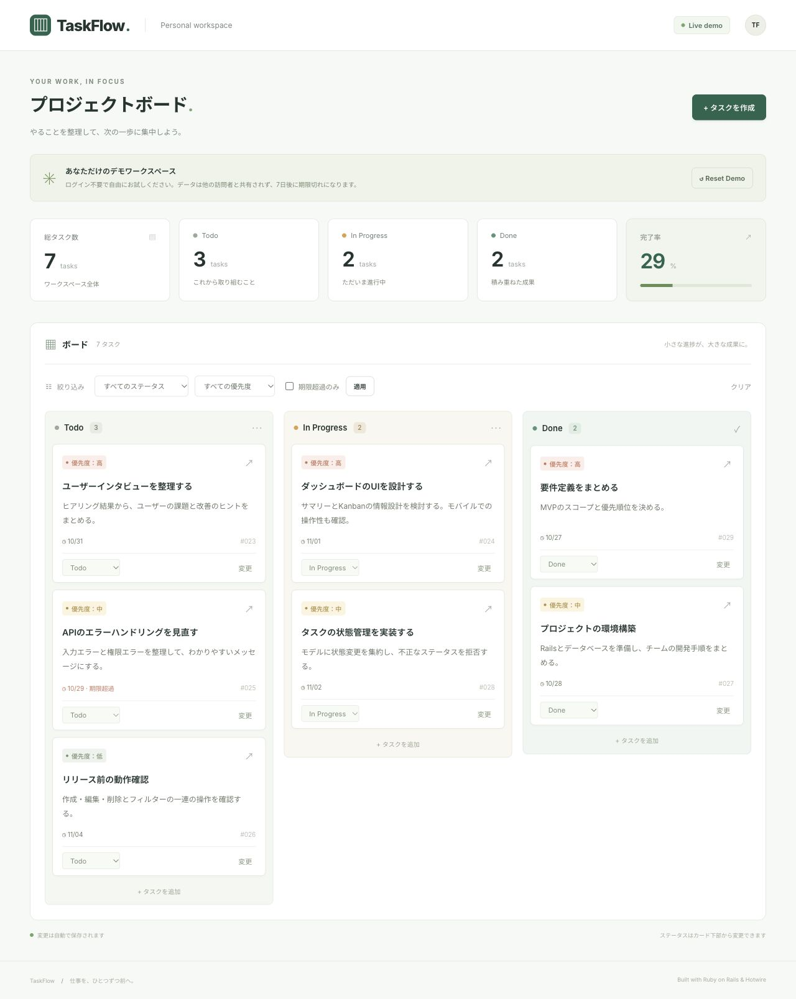
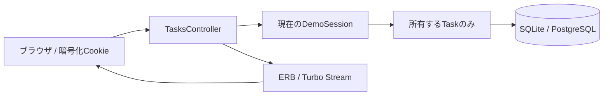
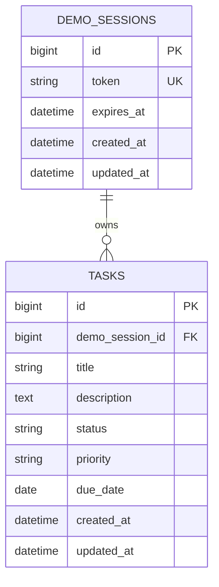

# TaskFlow

タスクの進捗・優先度・期限をまとめて把握できる、Rails製のタスク管理Webアプリです。

**ログイン不要。初回アクセスで自分専用のデモが作られ、すぐに操作できます。**

- **公開URL：Renderへのデプロイ後、ここに `https://実際のサービス名.onrender.com` を記載**（現時点では未公開）
- ソース：[Takafumi122/taskflow-rails](https://github.com/Takafumi122/taskflow-rails)
- ローカル：[http://localhost:3000](http://localhost:3000)

## スクリーンショット



モバイルではサマリーを2列、Kanbanを縦1列で表示します。

## 主な機能

- タスクの作成・一覧・詳細・編集・削除
- Todo / In Progress / Done のKanbanボード
- セレクトボックスによる状態変更とTurbo Streamでの即時更新
- ステータス・優先度・期限超過の絞り込み（組み合わせ可能）
- 総数・状態別件数・完了率。フィルターに関係なくワークスペース全体を集計
- 高→中→低の優先度順、同一優先度では期限順で表示
- 期限超過は「期限が今日より前、かつ未完了」と定義
- 初回アクセスで7件のサンプルを作成。Reset Demoで自分のデータだけを復元
- 入力エラー、タスクがない場合、絞り込み結果がない場合の表示
- 日本語UI、レスポンシブ対応、フォームラベル、キーボード操作

## 技術スタック

| 項目 | 採用技術 |
| --- | --- |
| 言語 | Ruby 3.4.12 |
| フレームワーク | Ruby on Rails 8.1.4 |
| UI | ERB / HTML / CSS、Hotwire（Turbo / Stimulus）、Importmap |
| DB | 開発・テスト：SQLite / 本番：PostgreSQL |
| サーバー | Puma |
| テスト | Rails標準 Minitest / ActionDispatch::IntegrationTest |
| CI | GitHub Actions、Brakeman、bundler-audit、Importmap audit |
| 公開先 | Render（Blueprint設定を同梱） |

Node.js、React、Redis、ログイン機能は不要です。依存の正確なバージョンは `Gemfile.lock` に固定しています。

## アーキテクチャ



Rails標準のMVC構成です。`ApplicationController` がCookie中のトークンから有効なデモを取得し、`TasksController` は常に `@demo_session.tasks` を経由します。任意のタスクIDを指定されても他の訪問者のデータには到達できず、404を返します。所有者IDはStrong Parametersで受け取りません。

## DB設計



- `demo_sessions`：token / expires_atはNOT NULL。tokenに一意インデックス、expires_atに削除対象抽出用インデックス。
- `tasks`：所有者・タイトル・ステータス・優先度はNOT NULL。外部キーと所有者のインデックスを設定。
- 所有者＋ステータス、所有者＋優先度、所有者＋期限の複合インデックス。
- CHECK制約でステータス・優先度の許可値、タイトル長1〜100文字をDB側でも保証。
- デモ削除時は `dependent: :destroy` で関連タスクも削除。

## バリデーションと状態管理

| 属性 | 制約 |
| --- | --- |
| タイトル | 必須、100文字以内（空白のみも拒否） |
| 説明 | 任意、5,000文字以内 |
| ステータス | `todo` / `in_progress` / `done` |
| 優先度 | `low` / `medium` / `high` |
| 期限 | 任意、厳密なYYYY-MM-DD形式。存在しない日付は拒否 |

`Task#transition_to` が状態変更を担当し、モデルのバリデーションを経由して保存します。3つの状態の間はどの方向にも移動できます。DoneからTodoへの差し戻しも可能です。不正な値では保存せず、HTTP 422を返します。通常の編集でも同じ検証が適用されます。

## 技術的な工夫

### デモの分離と安全性

- `SecureRandom.hex(32)` による256bitの推測困難なトークン。
- トークンはRailsの暗号化・改ざん検証付きCookieに保持。HttpOnly、SameSite=Lax、本番はSecure。
- 作成から7日間の固定有効期限。期限切れCookieでは新しいワークスペースを作り、古いデータを参照できません。
- リセットはPOST。削除とサンプル再作成を行ロック＋トランザクション内で実行。
- Rails標準CSRF保護とERBのエスケープを使用。トークンはパラメータログのフィルター対象。
- DBの連番IDはURLに出ますが、アクセス権の根拠にはせず、毎回所有者を照合します。
- `/up` はCookieやサンプルを作らないヘルスチェック。

### Hotwire

Stimulusはセレクト変更時のフォーム送信だけを担当し、状態変更の結果はTurbo Streamでボード・集計・通知に反映します。現在のフィルターを維持し、移動先が絞り込み対象外ならカードが消えます。JavaScriptを無効にした場合も「変更」「適用」ボタンで操作できます。

### 期限切れデータの削除

```sh
bin/rails demo:cleanup
# 本番では：
RAILS_ENV=production bundle exec rails demo:cleanup
```

期限切れデモとそのタスクだけをバッチ削除します。Render起動スクリプトでも毎回実行します。**常時稼働時にも毎日削除するには、外部スケジューラーかRender Cron Jobでこのコマンドを実行してください。** Render Cronは無料Webとは別の有料サービスのため、無料Blueprintには追加していません。DBへのアクセス期限は削除実行の有無に関係なく7日で切れます。削除は不可逆です。

## ローカル起動

### Rubyをインストール済みの場合

Ruby 3.4.12とBundlerを用意して実行します。macOS標準Ruby 2.6では動きません。

```sh
git clone https://github.com/Takafumi122/taskflow-rails.git
cd taskflow-rails
bundle install
bin/rails db:prepare
bin/rails server
```

[http://localhost:3000](http://localhost:3000) を開きます。SQLiteを使うのでローカルPostgreSQLは不要です。サンプルは初回アクセスで自動生成されるため、`db:seed` は必要ありません。

### Dockerを利用する場合

```sh
docker compose up --build
# 終了
docker compose down
```

SQLiteはホストの `storage/` に保存されます。ポート3000を使用します。

## テスト・検証

```sh
bin/rails test
bin/brakeman --no-pager
bin/bundler-audit
bin/importmap audit
RAILS_ENV=production SECRET_KEY_BASE_DUMMY=1 bin/rails assets:precompile
```

Dockerの場合：`docker compose exec web bin/rails test`。

モデル・結合テストは作成成功、必須項目・文字数・列挙値・日付の検証、状態変更、削除、組み合わせフィルター、他セッションの参照・変更・削除拒否、所有者IDの注入拒否、リセット、期限切れ、空状態、ヘルスチェックを扱います。CIでもテスト、セキュリティ検査、本番アセット生成を実行します。

開発時の検証記録は [docs/verification.md](docs/verification.md) に記載しています。

## Renderへのデプロイ

### Blueprintで作成

1. GitHubにこのリポジトリを公開。
2. [Render Dashboard](https://dashboard.render.com) にログインし、**New → Blueprint**を選択。
3. GitHub連携で `Takafumi122/taskflow-rails` を選び、`render.yaml` を読み込む。
4. Web ServiceとPostgreSQLの両方が **Free** であることを確認して作成。
5. ログでビルド・マイグレーション・起動の成功を確認し、割り当てられたURLを開く。
6. README冒頭の公開URLを書き換える。別ブラウザ／シークレットウィンドウで独立したデモになることを確認。

| 設定 | 値 |
| --- | --- |
| Runtime | Ruby |
| Build Command | `./bin/render-build.sh` |
| Start Command | `./bin/render-start.sh` |
| Health Check Path | `/up` |
| Ruby | 3.4.12 |
| `RAILS_ENV` | production |
| `SECRET_KEY_BASE` | Blueprintで自動生成 |
| `DATABASE_URL` | PostgreSQLから自動参照 |
| `BUNDLE_WITHOUT` | development:test |

ビルド時に依存をインストールしてアセットをプリコンパイル。起動時に `db:migrate`、期限切れデモ削除、Puma起動を実行します。無料Webではpre-deploy commandが使えないため起動時に移行しています。複数インスタンスに拡張する際はマイグレーションを単独のリリース処理へ移してください。

### 外部PostgreSQLを使う場合

Blueprintの `databases` を削除し、`DATABASE_URL` の `fromDatabase` を `sync: false` に変更してRenderの環境変数に接続URLを設定します。同一DBを使う環境間で `SECRET_KEY_BASE` を一致させ、漏えいさせないでください。秘密情報をGitにコミットする必要はありません。本アプリの本番起動には `RAILS_MASTER_KEY` は不要です。

## 制約と今後の改善

- デモは一時的です。Cookie削除、別ブラウザ、有効期限後は以前のデータを復元できません。個人情報や機密情報の入力は想定していません。
- アクセス制御は訪問者Cookie単位。Cookie自体の共有・盗難には別途対策が必要です。
- 期限切れデータの定期削除は、無料構成では起動時＋手動実行。厳密な毎日実行にはスケジューラーの設定が必要です。
- 一覧は全件表示。デモ用途を超える件数ではページング、作成件数制限、レート制限を検討します。
- 競合編集は最後の保存が優先。チーム向けには楽観ロックやユーザー権限が必要です。
- ドラッグ＆ドロップ、通知、認証、外部API連携はMVPの対象外です。
- E2Eのブラウザ自動テストは未導入。現時点では結合テストとブラウザでの操作確認を実施。
- WebフォントはGoogle Fontsを使用し、取得できない場合はシステムフォントにフォールバックします。
